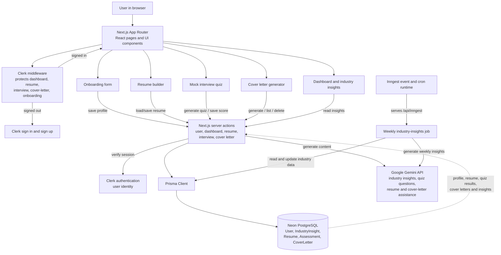

# Elevate Career Application Architecture

## Main request flows

- **Authentication:** Clerk provides sign-in and sign-up. Middleware protects the app's career features and redirects signed-out visitors to sign-in.
- **Onboarding:** The form submits profile details to a server action, which verifies the Clerk session and saves the profile through Prisma to Neon.
- **Career tools:** Resume, interview, and cover-letter pages call server actions. Those actions use Prisma for stored records and Gemini for generated content where needed.
- **Dashboard:** The dashboard reads the signed-in user's industry insights from Neon. If insights are missing, the dashboard action generates them with Gemini and stores them through Prisma.
- **Scheduled insights:** Inngest serves the `/api/inngest` route and runs the weekly industry-insights function, which reads and updates Neon data and calls Gemini.

## Technology summary

| Layer | Technology | Responsibility |
| --- | --- | --- |
| UI and routing | Next.js App Router, React | Pages, layouts, forms, and interactive career tools |
| Authentication | Clerk | User identity, sign-in, sign-up, and protected routes |
| Application logic | Next.js server actions | Authenticated reads, writes, and AI requests |
| ORM and persistence | Prisma, Neon PostgreSQL | Data access and durable application records |
| Generative AI | Google Gemini API | Industry insights, mock questions, resume and cover-letter content |
| Scheduled work | Inngest | Weekly industry-insight refresh |
