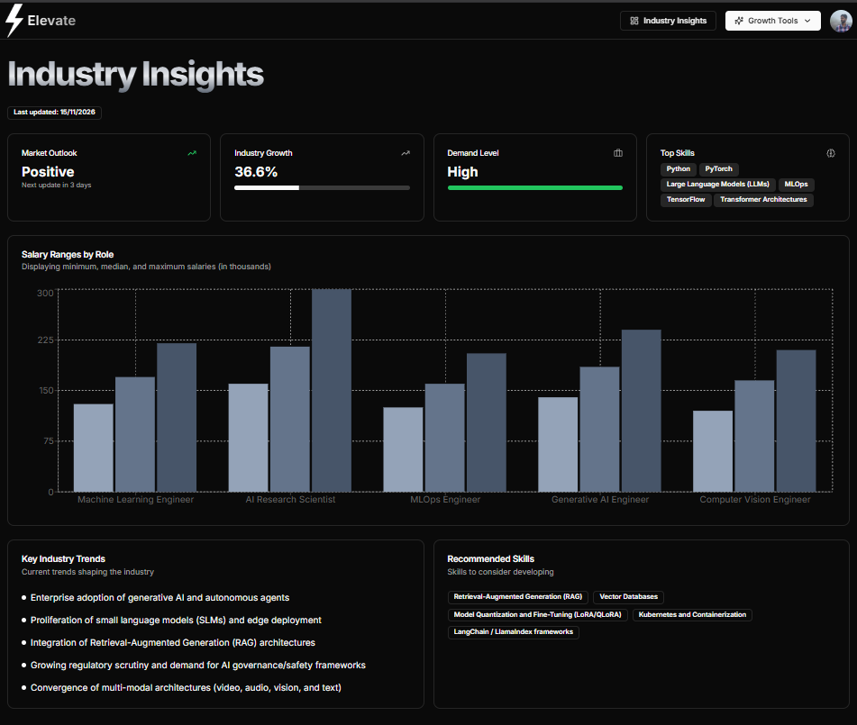
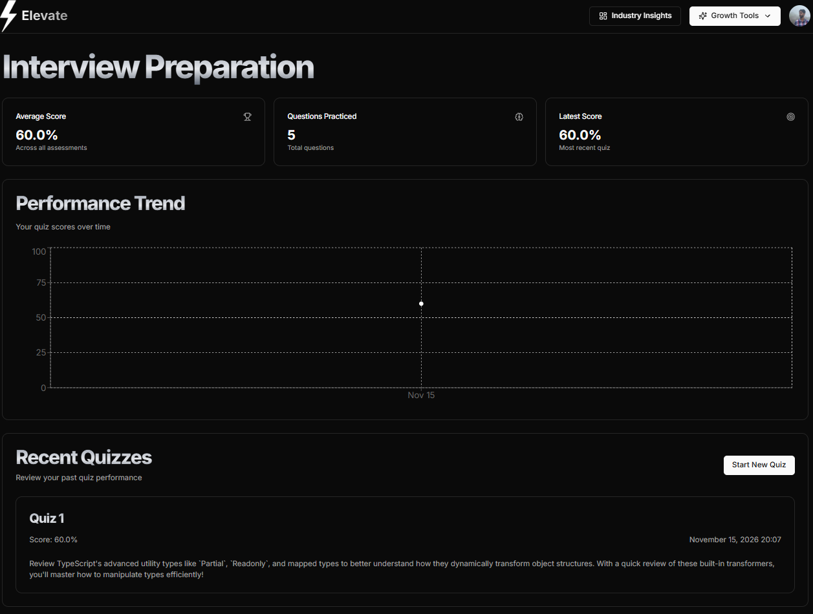

# Elevate Career AI 🚀

Elevate Career AI is an AI-powered career development platform designed to help users improve their career readiness. It brings together resume building, AI-powered mock interviews, cover letter generation, and industry insights.

## Key Technologies

- Next.js and React
- JavaScript and Tailwind CSS
- Prisma and PostgreSQL
- Clerk authentication
- Google Gemini API

**Local setup:** Run `npm run dev` from the project folder, then open the `Local:` URL printed by Next.js. This address is local to the computer running the server; no public demo has been deployed yet.

## Features

- **Career dashboard:** industry outlook, demand, salary ranges, skills, and trends tailored to the profile's selected industry.
- **Career profile onboarding:** save industry, experience, bio, and skills to personalize the tools.
- **Resume builder:** create and save a Markdown resume, use Gemini to improve selected content, and export the resume as a PDF. An ATS score and feedback are displayed when returned by the AI generation flow.
- **Mock interviews:** generate technical practice questions for the profile's industry, review answers and scores, and track assessment history and performance.
- **Cover letters:** generate job-specific drafts with Gemini, edit and revisit saved letters, and delete them.
- **Authentication and saved data:** Clerk protects career tools; user profiles and generated work are stored in PostgreSQL.
- **Scheduled industry insights:** an Inngest function refreshes saved industry data weekly.

## Screenshots

### Industry Insights



### Interview Preparation



## Technology stack

| Area | Technology |
| --- | --- |
| Web framework and routing | Next.js 15 App Router, React 19 |
| Styling and components | Tailwind CSS, Radix UI primitives, shadcn-style components |
| Authentication | Clerk (`@clerk/nextjs`) |
| AI generation | Google Gemini (`@google/generative-ai`) |
| Database access | Prisma ORM |
| Database | PostgreSQL (configured for Neon) |
| Background jobs | Inngest |
| Forms and validation | React Hook Form, Zod |
| Charts and export | Recharts, `html2pdf.js` |

## How the application is organized

The app uses the Next.js App Router. Public landing and legal pages live in `app/`; authenticated career features are grouped under `app/(main)/`. Clerk middleware protects the dashboard, onboarding, resume, interview, and cover-letter routes. The first dashboard visit redirects users without a saved profile to onboarding.

Page components render the UI and call server actions in `actions/` for authenticated data access and generation. Actions verify the Clerk identity, use Prisma (`lib/prisma.js`) to read and write PostgreSQL records, and call Gemini for generated guidance. The Prisma schema and migration are in `prisma/`.

Inngest exposes its handler at `/api/inngest`. Its scheduled function in `lib/inngest/function.js` refreshes stored industry insights every Sunday at midnight (as configured in code). See [ARCHITECTURE.md](./ARCHITECTURE.md) for the component diagram and request flows.

## Requirements

- Node.js 20 or newer and npm
- A PostgreSQL database (the project is configured for Neon)
- Clerk application keys
- Google Gemini API key
- An Inngest account/dev server to run and inspect scheduled functions

## Local installation

1. Clone the repository and enter the project directory:

   ```bash
   git clone https://github.com/kushalbt05/Carrer_coach.git
   cd Carrer_coach
   ```

2. Install dependencies:

   ```bash
   npm install
   ```

3. Create a local environment file from the template and fill in your own credentials:

   ```bash
   cp .env.example .env.local
   ```

   On PowerShell, use `Copy-Item .env.example .env.local` instead. Do not commit `.env.local` or paste real secrets into issue reports.

4. Apply the Prisma migrations to the configured PostgreSQL database and generate the client:

   ```bash
   npx prisma migrate deploy
   npx prisma generate
   ```

5. Start the development server:

   ```bash
   npm run dev
   ```

6. Open the `Local:` URL printed in the terminal (usually `http://localhost:3000`) and sign in through Clerk. If that port is occupied, use the URL for the next port printed by Next.js. For local Inngest development, start the Inngest dev server in another terminal and connect it to `<Local URL>/api/inngest`.

   On Windows, open PowerShell in the folder containing `package.json`, run `npm run dev`, and leave that terminal open. Wait for `Ready`, then open the exact `Local:` address shown in that terminal. If the terminal closes or the server stops, the localhost link stops responding.

## Environment variables

Copy [.env.example](./.env.example) to `.env.local` and provide values for the following variables. The Clerk keys come from your Clerk application; `DATABASE_URL` should be a PostgreSQL connection string; `GEMINI_API_KEY` should be a Google AI Studio API key.

| Variable | Purpose |
| --- | --- |
| `NEXT_PUBLIC_CLERK_PUBLISHABLE_KEY` | Clerk browser/application identifier (publishable key) |
| `CLERK_SECRET_KEY` | Clerk server-side authentication key |
| `DATABASE_URL` | PostgreSQL connection string used by Prisma |
| `GEMINI_API_KEY` | Gemini API key used by career generation and industry insights |

The code reads `GEMINI_API_KEY`; `GOOGLE_API_KEY` is not currently referenced by the application. Inngest's local development server can run without a separate project secret; configure Inngest credentials in its dashboard when deploying scheduled functions.

## Useful commands

| Command | Description |
| --- | --- |
| `npm run dev` | Start the local Next.js development server |
| `npm run build` | Build the production application |
| `npm run start` | Serve a production build |
| `npx prisma studio` | Open Prisma Studio to inspect configured database records |
| `npx prisma migrate deploy` | Apply checked-in migrations to the configured database |

## Project structure

```text
app/                  Routes, layouts, API endpoint, and feature UI
  (auth)/             Clerk sign-in and sign-up pages
  (main)/             Dashboard, onboarding, resume, interview, cover-letter tools
  api/inngest/        Inngest function endpoint
actions/              Server actions for profile and career tools
components/           Shared UI and landing page components
data/                 Static landing page and industry content
lib/                  Prisma client, Clerk helpers, and Inngest jobs
prisma/               PostgreSQL schema and migrations
public/               Static images, icons, and branding
ARCHITECTURE.md       System diagram and request flow notes
```

## Notes

- AI output is generated content and should be reviewed before using it in an application or career decision.
- The environment files `.env` and `.env.local` are ignored by Git. Keep credentials in your local environment or secret manager.
- The project currently defines `lint` as `next lint`; check the installed Next.js CLI behavior if that command is unavailable in your environment.

## Repository description

Elevate Career AI is an AI-powered career development platform designed to help users improve their career readiness. It brings together resume building, AI-powered mock interviews, cover letter generation, and industry insights.
